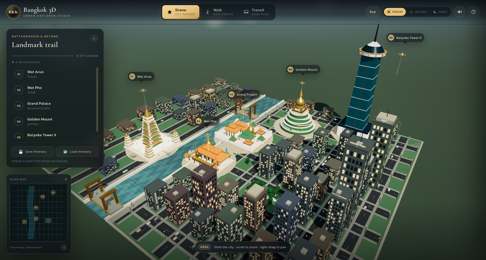
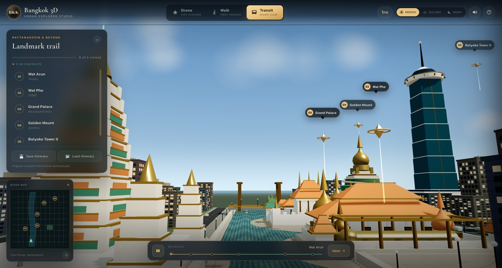
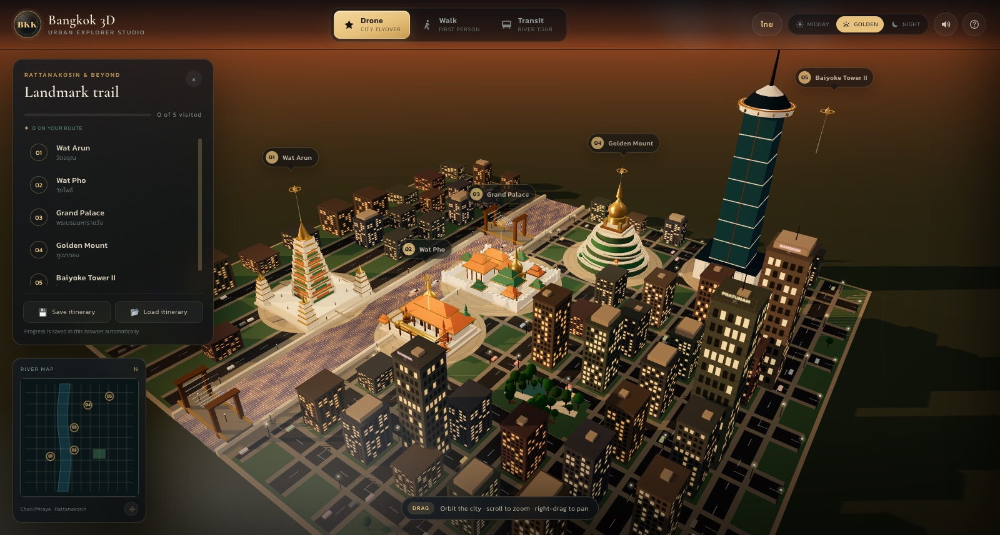
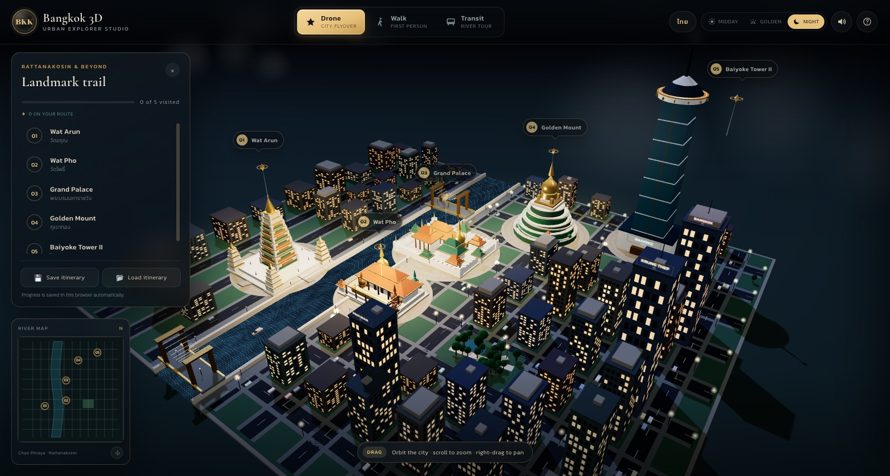
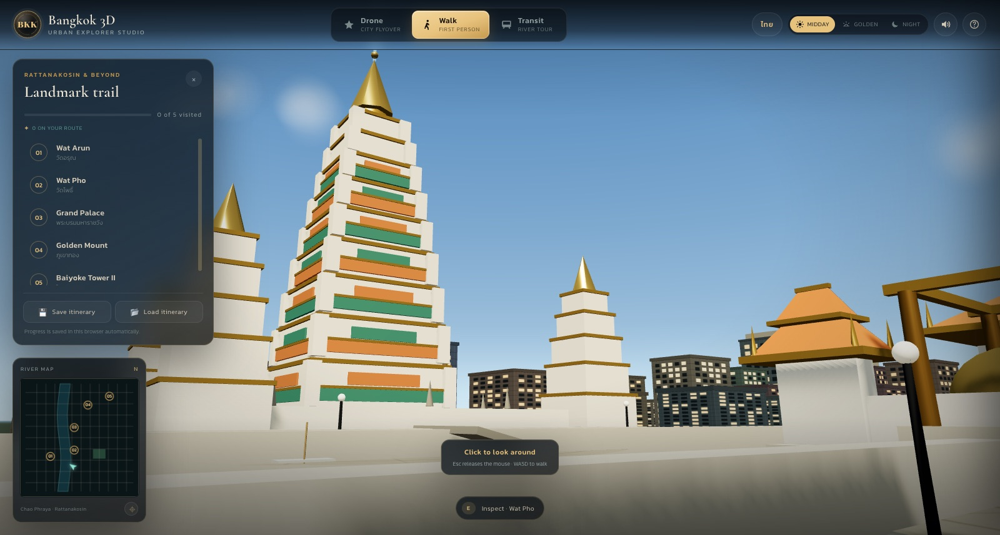
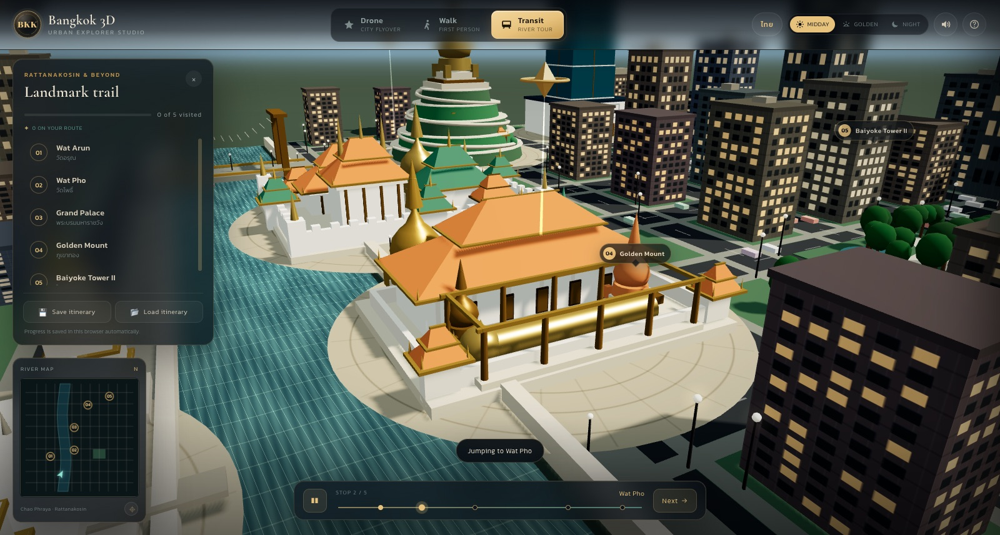
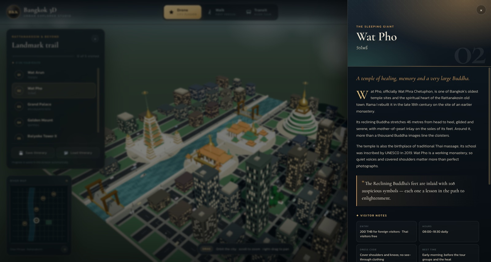
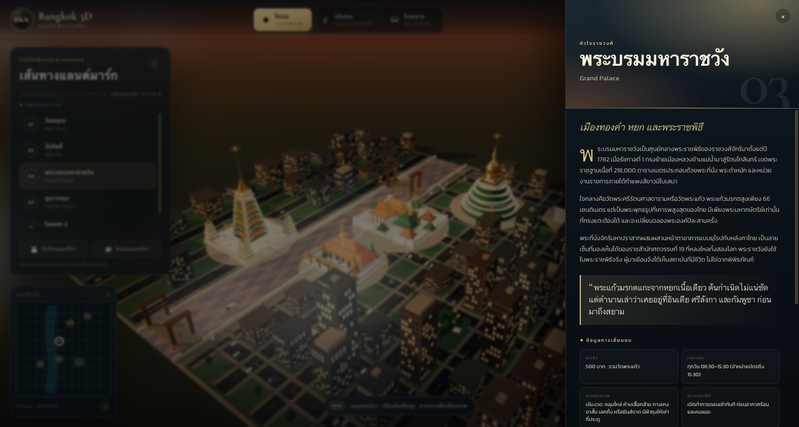
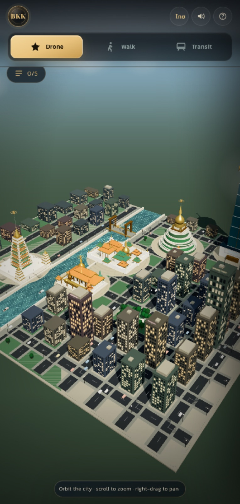

# Bangkok 3D — Interactive Urban Tourist Guide & Explorer Studio

An interactive miniature of Bangkok in a single browser experience: fly over the Chao Phraya, walk the
Rattanakosin riverfront in first person, or let an automated river tour carry you between five
landmarks. Everything is bilingual (English / ไทย), lit by three time-of-day presets, and scored with
synthesised city sound.

**Live demo:** <https://somphol.github.io/bangkok-3d-tour-guide/>  
**Stack:** vanilla HTML5, CSS3, ES6 JavaScript, Three.js r128 (CDN). No build step, no framework, no
API keys, no tracking.



## The five landmarks

| # | Landmark | What you see |
| --- | --- | --- |
| 01 | **Wat Arun** (วัดอรุณ) | Porcelain-banded central prang, four satellite prangs and a gilded spire on the west bank |
| 02 | **Wat Pho** (วัดโพธิ์) | Cloisters, four chedis and the 46 m Reclining Buddha under an open canopy |
| 03 | **Grand Palace** (พระบรมมหาราชวัง) | Crenellated white walls, Wat Phra Kaew, the golden chedi and the Chakri Maha Prasat |
| 04 | **Golden Mount** (ภูเขาทอง) | Terraced man-made hill, spiral path, slope pavilions and the golden chedi |
| 05 | **Baiyoke Tower II** (ใบหยก 2) | 304 m tower with a glass shaft, observation crown and red aircraft beacon |

Each landmark has a floating, bobbing gold marker and a bilingual guide drawer with history, a fact,
entry fee, hours, dress code, transit directions and the best time to visit. Any landmark can be marked
visited, added to a custom route, and annotated with private notes.

## Three ways to explore

- **Drone city flyover** — OrbitControls: drag to rotate, wheel to zoom, right-drag to pan. A cinematic
  orbit plays behind the title screen. Each landmark has a “Fly here” camera move.
- **First-person street walk** — click the scene to capture the mouse, then WASD / arrows to walk,
  Shift to run, mouse to look, `E` to inspect the nearest landmark, `Esc` to release. Movement is
  blocked by buildings, trees, temple bases and the riverbank. Footsteps follow walking speed.
- **Automated transit tour** — a Catmull-Rom river-and-city route with five dwell stops. Pause with
  `Space`, jump with `N` or the Next button; the tour resumes where you left it.



## Bilingual, lit and audible

- **EN ⇄ ไทย** switches every header, button, toast, hint, landmark title, story, fact and visitor note.
  The change is instant and persists.
- **Midday / Golden hour / Neon night** transition the sky shader, sun colour and angle, fog, water,
  exposure, lit windows, street lamps, neon signs and the temple floodlights.
- **Web Audio API** synthesises a river bed, traffic rumble, air, spatial temple bells and footsteps.
  Bells are panned in 3D from Wat Arun; walking triggers distance-synced steps. No audio files.
- **Device narration** reads the open landmark's story in English or Thai via `speechSynthesis`.




## Save, export, restore

- Progress is saved automatically to `localStorage` under `bangkok3d.state.v1` (visited landmarks,
  route, notes, language, lighting, camera mode, sound preference).
- **💾 Save itinerary** downloads `bangkok_3d_tour.json` with app metadata, visited IDs, route, notes,
  stats and credits.
- **📂 Load itinerary** restores a file on any device. Input is shape-checked and sanitised; unknown
  landmark IDs and oversized notes are dropped.
- Nothing is sent anywhere. The exported JSON is the only way data leaves the browser.

## Run it

The site is fully static. Serve the folder (recommended, so the CDN and Google Fonts can be cached
normally):

```sh
cd bangkok-3d-tour-guide
python3 -m http.server 8000
open http://127.0.0.1:8000/
```

`index.html` also opens directly from disk; it still needs internet for the Three.js CDN and fonts.

### Verify

```sh
node --check script.js
open 'http://127.0.0.1:8000/?selftest=1'
```

The self-test runs 23 checks in the page: scene construction, five landmarks/markers/labels, bilingual
key parity, tour stop ordering, lighting presets, walk colliders, traffic instances, the water shader,
state round-tripping, export schema/filename, note sanitising, minimap, audio class, WebGL context,
mode switching and language switching. It displays the pass count on screen and in the console.
Current result: **23 / 23**.

### Debug URL parameters

| Parameter | Effect |
| --- | --- |
| `?reset=1` | Clear the saved state before boot (handy for screenshots) |
| `?autostart=1` | Skip the title screen |
| `?mode=drone\|walk\|tour` | Start in a camera mode |
| `?preset=day\|golden\|night` | Start with a lighting preset |
| `?lang=en\|th` | Start in a language |
| `?drawer=wat-pho` | Open a landmark guide on load |
| `?selftest=1` | Run the self-test panel |
| `?cam=x,y,z&look=x,y,z` | Place the drone camera (screenshot/debug) |

## Controls

| Input | Action |
| --- | --- |
| `1` / `2` / `3` | Drone / Walk / Transit |
| Drag, wheel, right-drag | Orbit, zoom, pan (drone) |
| `WASD` / arrows | Walk |
| `Shift` | Run |
| Mouse (after click) | Look |
| `E` | Inspect nearest landmark (walk) |
| `Space` | Pause / resume the tour |
| `N` | Next tour stop |
| `L` | Switch language |
| `T` | Cycle lighting |
| `M` | Sound on/off |
| `H` or `?` | Help |
| `R` | Recenter the drone |
| `Esc` | Close drawer / help / release pointer lock |




## Bilingual guide and mobile layout





## Project structure

```
index.html             DOM, HUD, intro, guide drawer, pinned CDN script tags
style.css              design system, glass panels, responsive layout, Thai typography
script.js              one ES6 IIFE, eight labelled sections, no build step
screenshots/           final renders (1600 px JPEG; mobile at 430 px)
state.json             build/token/model record for this session
STATE.md               human-readable build record
```

### How `script.js` is assembled

1. **Copy** — `I18N` (EN/TH UI strings) and `LANDMARKS` (bilingual stories, tips, coordinates, views).
2. **State** — schema, validation, `localStorage` persistence.
3. **World setup** — renderer, sky shader, stars, sun/moon sprites, lights, materials, facade textures.
4. **Procedural city** — river, embankments, promenade, roads, bridges, blocks, parcels, parks, trees,
   traffic, boats, lamps, railings.
5. **Landmarks** — five hand-built groups, markers, pick volumes and plaza rings.
6. **Camera** — OrbitControls, PointerLockControls, collision-aware walking, spline tour state machine.
7. **UI** — bilingual HUD, drawer, minimap, audio synthesis, narration, export/import.
8. **Boot / self-test / debug API** (`window.Bangkok3D`).

Coordinates: X is east–west, Z is north–south, Y is up; one unit ≈ a few metres. The Chao Phraya runs
north–south near `x = -26`. Geography is compressed and interpretive.

## Notes and limits

- **Not a survey map.** Landmark positions, distances and heights are stylised so five sites fit one
  readable diorama. Do not use it for navigation.
- **Prices and hours are a snapshot, not live data.** Confirm with official sources before travelling.
- **Walk mode is keyboard + mouse.** On touch devices the HUD explains this; drone and tour work with
  touch. The walk area is the east bank only; the river is a boundary.
- **Audio needs a user gesture.** The “Enter the city” button and sound toggle initialise it; browsers
  block autoplay by design. Narration depends on installed system voices.
- **Headless verification** runs under SwiftShader at a few frames per second; the scene is built for
  a hardware-accelerated browser.
- Three.js r128 is pinned in `index.html`; changing the version requires re-checking the non-module
  `OrbitControls` / `PointerLockControls` examples.

## Credits

- Built with **[OpenCode](https://opencode.ai)** (2.2.5) and **DeepSeek V4.1 Flash**
  (`opencode-go/deepseek-v4.1-flash`).
- [Three.js](https://threejs.org) r128, MIT — plus the r128 OrbitControls and PointerLockControls
  examples.
- Fonts served by Google Fonts: **Chonburi**, **Kanit** (Cadson Demak) and **Cormorant Garamond**
  (Christian Thalmann), under the SIL Open Font License 1.1.
- All geometry, textures, audio and copy in this repository are original; no photographs or map tiles
  are redistributed. See [THIRD_PARTY_NOTICES.md](THIRD_PARTY_NOTICES.md).

Built as a self-contained city guide; the build record (time and tokens) is in [STATE.md](STATE.md).
