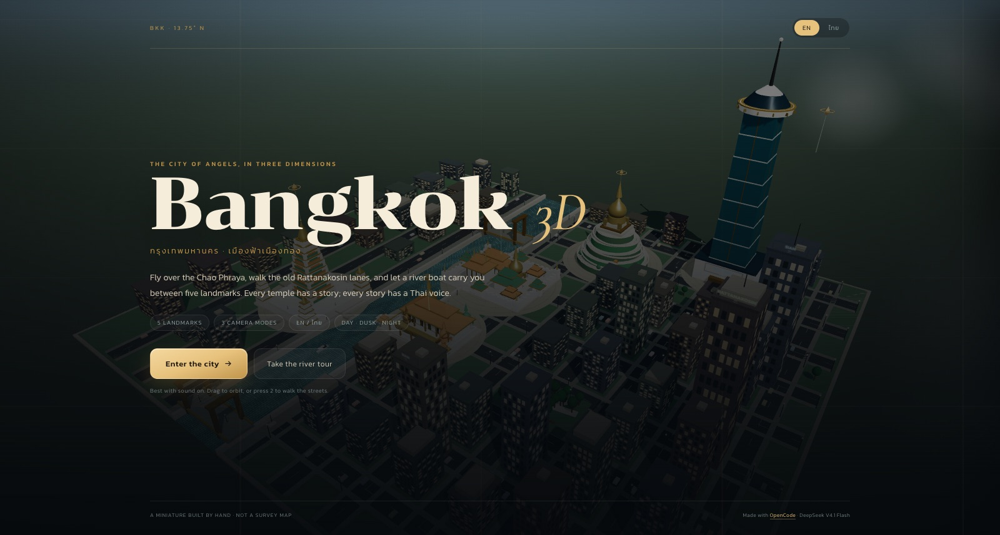
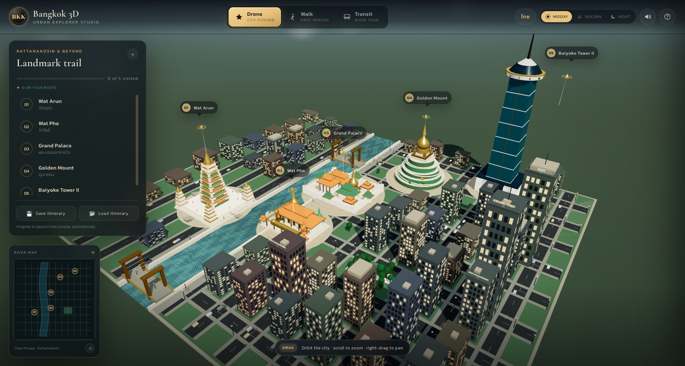
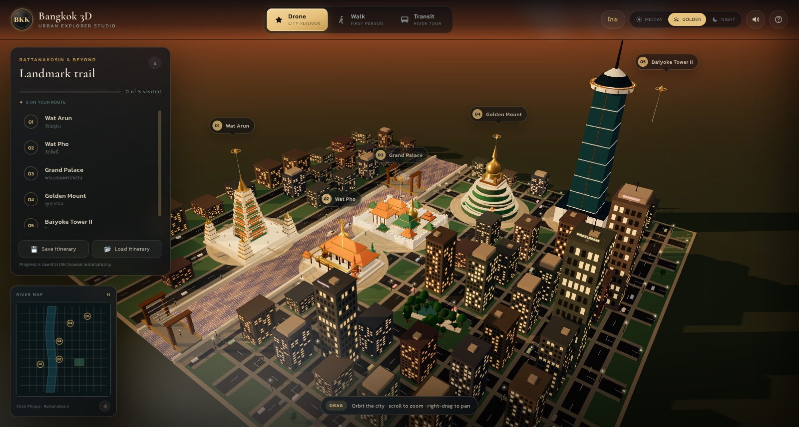
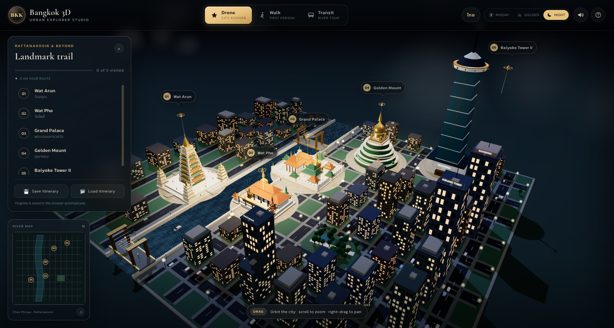
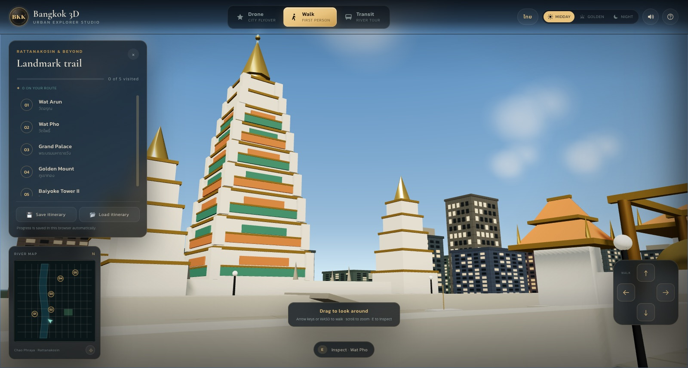
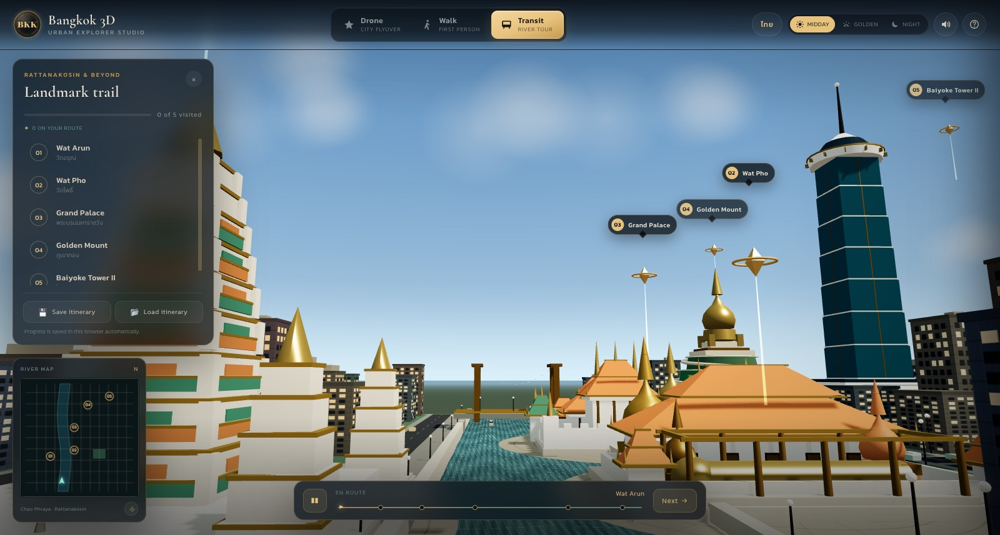
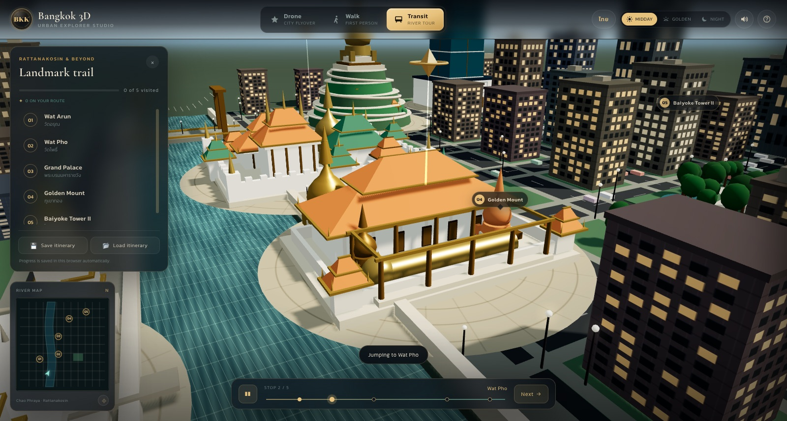
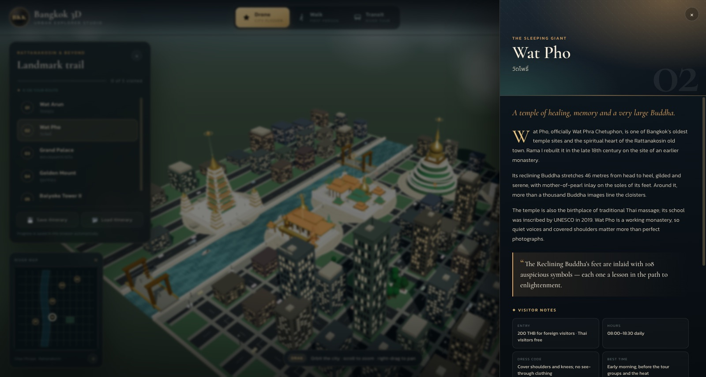
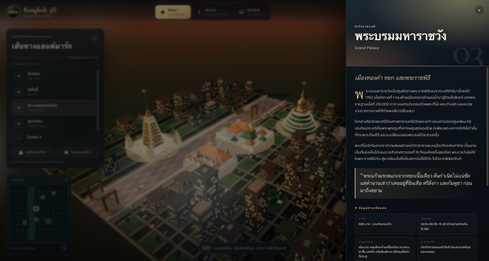
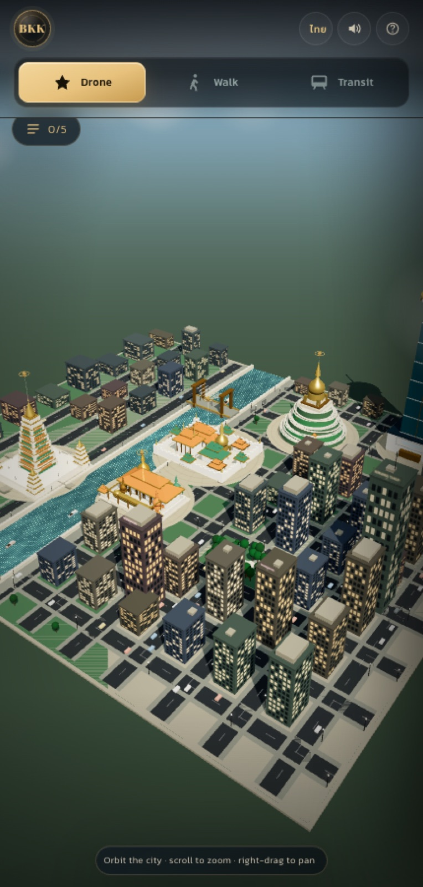

# Gallery

Release renders from the current build. Images are 1600 px JPEGs (mobile at 430 px) and live in
[`screenshots/`](../screenshots).

## Title screen

[](../screenshots/01-intro.jpg)

The editorial cover: city behind glass, Bangkok 3D, language toggle and the two entry paths.

## Drone flyover

[](../screenshots/02-drone-day.jpg)

Midday: the full diorama, five landmark markers and the river axis.

[](../screenshots/03-drone-golden.jpg)

Golden hour: warm sky, long shadows, lit windows and gold detail.

[](../screenshots/04-drone-night.jpg)

Night: lamp glows, neon signs, illuminated temples and the Baiyoke beacon.

## Street walk

[](../screenshots/05-walk.jpg)

Walk mode from the river promenade: drag to look, arrow pad or arrow keys to move, scroll to zoom.

## Transit tour

[](../screenshots/06-tour-river.jpg)

The automated river leg, framed between Wat Arun and the Rattanakosin roofs.

[](../screenshots/07-tour-stop.jpg)

Stop 2: Wat Pho’s open canopy and the Reclining Buddha, with the transit bar and progress nodes.

## Guide drawer

[](../screenshots/08-guide.jpg)

The bilingual visitor drawer: story, fact, visitor notes, entry/hours/dress/transit tips.

[](../screenshots/09-thai.jpg)

Thai interface and copy for the Grand Palace.

## Mobile

[](../screenshots/10-mobile.jpg)

The 430 × 900 layout: compact top bar, trail button and full-width drawer.

## Reproducing the renders

Open the app with a reset state and the relevant parameters, wait for the loader to finish, then capture:

```text
?reset=1&autostart=1&mode=drone
?reset=1&autostart=1&preset=golden
?reset=1&autostart=1&preset=night
?reset=1&autostart=1&mode=walk
?reset=1&autostart=1&mode=tour
?reset=1&autostart=1&drawer=wat-pho
?reset=1&autostart=1&lang=th&drawer=grand-palace
```

Use 1600 × 1000 for desktop and 430 × 900 for mobile. The images are illustrative of the compressed
diorama, not survey imagery.
